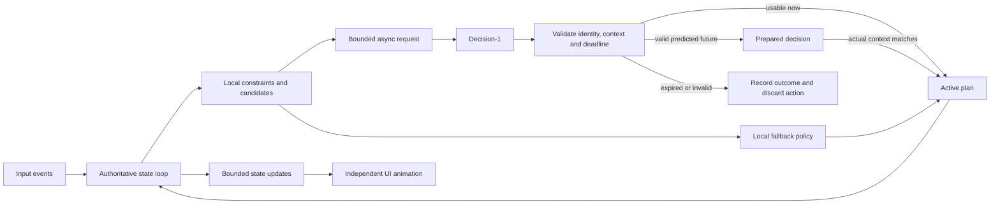

# Microsoft-Decision-1: realtime application handoff

This guide records what we learned building Decision Arcade, a Tetris application with a Node.js server, `ws`, and vanilla JavaScript. Use it when designing future games, dispatchers, interactive tools, routing systems, and other applications that need decisions while their state keeps changing.

The development server was stopped at handoff. This document does not require starting it. See [README.md](README.md) for application setup.

## Start here

The useful pattern is to let ordinary code maintain valid state, calculate facts, and execute actions, while Decision-1 selects among well-defined alternatives. Schedule the decision early enough to remain useful. Keep the application moving while the request is pending, then validate the result against the current state before applying it.

For the next agent:

1. Define the decision's useful lifetime and the behavior when that lifetime expires.
2. Calculate hard constraints and candidate outcomes locally.
3. Send a compact, bounded question at a meaningful state change.
4. Keep rendering, simulation, and inference on independent schedules.
5. Carry entity identity, state context, and request identity through the async operation.
6. Prepare the next likely decision only when its predicted state can be validated later.
7. Choose an explicit fallback policy and distinguish its actions from model actions.
8. Measure latency distributions, applied decisions, missed deadlines, and application outcomes together.

These are application design lessons. We did not establish the model's universal latency, maximum throughput, or optimal deployment configuration.

## 1. The model contract we used

Decision-1 accepts shared `state` and named typed questions. `choice` selects an option, `noul` gives a yes/no probability, and `score` evaluates an ordered scale. We exercised **choice only**. It does not supply a generated written rationale. [Microsoft API guide](https://learn.microsoft.com/en-us/azure/foundry/foundry-models/how-to/use-foundry-models-microsoft-decision)

Our integration sends `POST /providers/microsoft/v1/systemone` with an `api-key` header. `model` contains the actual deployment name. Responses identify answers by question name; the returned model name can differ from the deployment name. [Request contract](https://learn.microsoft.com/en-us/azure/foundry/foundry-models/how-to/use-foundry-models-microsoft-decision#call-the-decision-api)

A generic request for a future dispatcher could look like this. Candidate eligibility and the numerical facts must already have been checked by the application:

```json
{
  "model": "your-deployment-name",
  "state": {
    "job": "image-resize",
    "priority": "normal",
    "workersVersion": 42
  },
  "questions": {
    "worker": {
      "type": "choice",
      "instructions": "Choose an eligible worker. Prefer lower queue time and adequate spare capacity.",
      "criteria": {
        "worker_a": "queue_ms=180, spare_slots=4",
        "worker_b": "queue_ms=30, spare_slots=2"
      }
    }
  }
}
```

On receipt, validate the answer type and the selected ID against **that request's** candidate map. Recheck worker availability before assignment. A valid answer can still describe an option that has become unavailable.

Our [request builder and response parser](src/decision.js) are the concrete reference. They validate the choice and only expose supplied probabilities that are finite numbers in `[0, 1]`. We do not invent a probability when one is missing.

## 2. What we measured

### Request size and latency

These are measurements from this project's environment and configured endpoint. Sample sizes are small, request contexts differ, and remote conditions varied between runs.

| Measurement | Observed result | Interpretation |
| --- | --- | --- |
| Original representative request | 2,965 bytes; 857 input tokens | Included repeated facts and long descriptions. |
| Compact representative request | 1,258 bytes; 407 input tokens | About 58% fewer bytes and 53% fewer input tokens. |
| Early full-request warm sample | P50 348 ms; P95 370 ms; 3 samples | A useful baseline, not an SLA. |
| Early compact-request warm sample | P50 322 ms; P95 327 ms; 3 samples | A modest improvement in that comparison. |
| Later compact-request warm sample | P50 450 ms; P95 1,115 ms; 5 samples | Provider/network variation remained substantial. |
| Later minimal 44-token request | P50 389 ms; P95 1,084 ms; 5 samples | Tiny input still had hundreds of milliseconds of roundtrip latency. |
| Local candidate simulation | Median about 0.5–0.7 ms across profiling runs | Local computation was much smaller than the remote roundtrip. |
| First request in the latest profiler process | 2,076 ms | Startup behavior must be measured separately. |

The application timer includes request preparation, network transit, provider routing/processing, response download, and parsing. It does **not** isolate inference time. `headersMs` also includes the time until the provider returns response headers; it is not a measurement of network transit alone.

The profiler excludes round zero from each variant's warm summary. The variants share a process and connection pool, so the first request for each variant is not necessarily a new TCP/TLS connection. The first request in the process is the more useful startup observation.

We did not isolate CPU optimizations in a controlled before/after experiment. Caching removes repeated work, but the local timing samples do not prove a particular CPU speedup.

### Application outcomes at 4×

| Run | Duration/status | Pieces placed | Lines cleared | Model responses | Local safety moves |
| --- | --- | --- | --- | --- | --- |
| Before deadline/pipeline refactor | Top-out after 4.390 s | 12 | 0 | 5 | No safety steering |
| After, first comparison | Still running after 20.045 s | 36 | 11 | 34 | 14 |
| After, longer check | Still running after 60.033 s | 126 | 45 | 116 | 51 |

The longer run recorded 70 successful model placement outcomes, 43 late model choices, and 3 unreachable model choices. Its model-response median was 454.2 ms.

**The survival improvement includes local safety steering.** It is evidence for the combined application strategy, not proof that the model alone played every piece or that API latency disappeared. The outcome log is not a complete, reconciled per-piece attribution ledger. Do not force its counters into an exact partition of all pieces or derive model accuracy from them.

The gameplay runs used the same deterministic piece generator, but remote responses and timing were not deterministic. We did not independently measure the contribution of every optimization, establish indefinite survival, or compare against a broad set of seeds and board distributions.

Local evidence files, when present:

- `performance-results/comparison.json`
- `performance-results/latency-profile.json`
- `performance-results/gameplay-after-60s.json`

`performance-results/` is Git-ignored. Share those files explicitly if another agent needs the raw samples; they may be absent from a clean checkout. The important observations are preserved in this document.

## 3. Treat latency as a deadline problem

The first design froze gravity while awaiting the model. It kept the request's board valid but caused a visible stop at every piece.

The next design allowed gravity to continue, but pieces fell in their starting columns until the API answered. At 4×, many replies arrived too late to help. Smooth animation alone did not solve this scheduling problem.

In the current game:

```text
automatic gravity interval = 125 ms / playback speed
at 4×: one row every 31.25 ms

rough available time = remaining falling rows × 31.25 ms
20 rows ≈ 625 ms
10 rows ≈ 312.5 ms
```

Actual time depends on piece shape, board height, and lock timing. Steering and server scheduling consume some of that budget. A roughly 450 ms request cannot reliably control a piece with approximately 300 ms of useful lifetime.

Use this budget for a new application:

```text
required lead time = queue delay + request latency + validation + execution margin
remaining budget = action deadline - current time
```

Measure the tail of the distribution, not only its median. If the required lead time exceeds the remaining budget, move the decision earlier, use an acceptable local action, defer the operation, or redesign the interaction.

Also check capacity. With one request in flight per entity, a 450 ms average service time supports roughly 2.2 serial responses per second before other overhead. If the application needs more useful decisions than that, lookahead alone cannot create throughput. Reduce decision frequency, coalesce obsolete work, or change the policy/model/architecture.

For future projects, track both response latency and **decision age at application**. A fast response based on an old queued event may already be useless.

## 4. What we changed and why

| Change | Mechanism | Reference | Reusable lesson |
| --- | --- | --- | --- |
| Compact requests | Send each candidate's facts once; shorten repeated instructions; compact the board representation. | `buildDecisionRequest()` in [src/decision.js](src/decision.js) | Remove redundant context before adding infrastructure. Preserve units and meanings. |
| Local legal candidates | Simulate outcomes and filter invalid moves before the model sees them. | `enumeratePlacements()` in [src/tetris.js](src/tetris.js) | Let code enforce hard constraints; ask the model for judgment among valid choices. |
| Independent clocks | Gravity continues while inference and steering run separately. | `tick()` in [src/session.js](src/session.js) | Keep state progression outside the remote request's await chain. |
| Continuous rendering | Animate between server snapshots with `requestAnimationFrame`. | `drawBoard()` / `animate()` in [public/app.js](public/app.js) | UI frame rate and inference frequency serve different purposes. |
| One-step lookahead | Predict the board after the current confirmed placement; request the next piece's choice early. | `context(true)` / `ensureDecision()` | Overlap useful work with latency when the future state is predictable. |
| Validation at use time | Compare predicted and actual boards; find a reachable route from the current pose. | `ensureDecision()` / `requestDecision()` | A prepared response is conditional until its context is confirmed. |
| Local safety steering | Supply provisional movement while awaiting a response; label completed local actions. | `ensureDecision()` / `record()` | Choose a domain-appropriate fallback and expose its contribution. |
| Cached geometry | Precompute and freeze the seven pieces' rotations. | `ROTATIONS` / `shapeFor()` | Cache immutable domain facts rather than rebuilding them in tight loops. |
| Cheaper route validation | Search for a path to the selected target without scoring every possible board again. | `reachablePlacement()` | Separate validity checks from full ranking work. |
| Smaller request context | Copy the active pose and next-piece list; retain the immutable board reference. | `context()` | Capture required inputs rather than cloning unrelated runtime/telemetry state. |
| Cached percentiles | Calculate P50/P95 when a response arrives. | `record()` / `snapshot()` | Keep analytics work off the broadcast loop. |
| Bounded diagnostics | Retain 20 decision records, 10 raw responses, and 500 latency samples. | `record()` | Bound memory and serialization costs. |
| Versioned diagnostic updates | Omit unchanged history/response bodies from regular state messages. | `publish()` | Avoid retransmitting large inspection data on every frame. |

The raw response panel was retained because profiling did not identify it as the main delay. Removing a requested inspection feature would not remove the hundreds of milliseconds spent awaiting a remote response.

The native Node `fetch` path was retained. We did not establish that a replacement SDK, custom connection agent, HTTP/2 transport, or a new connection pool would improve this workload. Benchmark transport changes rather than assuming they help.

### Request design details

Our shortlist contains up to eight moves. Eight is a project choice, not a universal optimum or a verified service limit.

Each move has a request-local ID and locally computed outcome metrics: line clears, holes, total height, peak height, roughness, column, and rotation. The full board and next pieces add context. We removed a second copy of those same candidate metrics from `state` and reduced prose in each option.

The model can only choose from this shortlist. Its performance depends on candidate coverage, the local heuristic, and the wording of the objective. Evaluate the candidate generator and the final selector separately. A useful choice omitted from the shortlist cannot be recovered by the model.

For another domain, send compact facts that affect the decision. Keep units explicit. Avoid shortening names into ambiguous codes merely to save a few tokens. Evaluate prompt changes for decision quality as well as request size.

## 5. Reusable asynchronous architecture



### Carry identity through every request

The current implementation uses `pieceId`, `epoch`, and `job`:

- `pieceId` identifies which piece a decision concerns.
- `epoch` invalidates a session's work after pause, reset, mode change, or disconnect.
- `job` distinguishes requests and prevents an older completion/finalizer from altering a newer request.
- `parentTarget` binds a future request to the placement whose predicted board it assumes.

The current board is replaced on placement rather than mutated in place. That makes retained board references usable snapshots. If another application mutates nested state, it must copy the necessary fields or adopt immutable/versioned state. Reusing a mutable object is not a snapshot.

For a future application, a request context can contain:

```js
const context = {
  entityId,
  entityVersion,
  requestId,
  candidateMap,
  predictedParentVersion,
  deadlineAt,
};
```

Use the selected ID to retrieve the action from this context's candidate map. IDs such as `move_1` are reused across requests and cannot identify an action without their context.

An explicit `deadlineAt` is a recommendation for reuse. The current game primarily detects expiry through piece identity and physical reachability; it does not implement this exact generic schema.

### Bound work instead of accumulating a queue

The game allows one remote request in flight per session and stores at most one prepared decision. It does not launch model requests at the 20 Hz server update rate or browser frame rate.

For rapidly changing entities, coalesce obsolete pending work and reconsider the latest valid state when capacity becomes available. Preserve required events separately when every event has business meaning. The appropriate queue policy depends on the domain.

One request per session is not a global spending or concurrency limit. This local app allows multiple sessions. A production multi-user service would need deployment-wide controls in addition to per-entity scheduling.

### Prepare one decision ahead only when prediction is useful

Our sequence is:

1. Receive a model choice for the active piece and confirm it is reachable.
2. Simulate the board after that exact placement.
3. Request a choice for the known next piece against that predicted board.
4. Keep the active piece falling.
5. At the next spawn, compare actual and predicted boards and validate the route again.
6. Apply the prepared choice or discard it and request from the actual state.

If the parent plan becomes invalid, cancel its dependent request and prepared result. Pause/reset/disconnect invalidate both current and future work.

This pattern suits predictable next steps. For highly unpredictable state, speculative requests can waste capacity. Measure prepared-choice acceptance and discard rates before increasing lookahead depth. We implemented one step, not a branching search over many possible futures.

### Keep fallback behavior explicit

While a model response is pending, the game steers toward a locally selected valid placement. A timely, reachable model choice can take over. If local steering completes the placement first, the history records `fallback` and the UI displays **Local safety**.

Latency and source attribution remain separate:

- Local preparation time is not added to the model latency chart as a model response.
- A successful API response does not imply its action was executed.
- Prepared, planned, placed, late, unreachable, and cancelled are different outcomes.
- A forced move with only one valid option requires no remote judgment.

Fallback choices for other projects could include keeping a still-valid plan, queueing a job, selecting a deterministic eligible option, or asking for human input. Select a policy that fits the operation. Tetris's provisional movement is not a suitable default for every application.

### Preserve cancellation and result validation together

`AbortController` reduces unnecessary local waiting. Epoch/job checks protect state even when cancellation races with completion. Both are required. An obsolete request's `finally` block must not clear a newer request's controller or pending state.

In this app, API failures pause live play with an error. Local safety handles pending/late decisions; it does not silently convert HTTP failures into successful model decisions. Retries are manual and create new requests. An aborted local request may already have reached the provider and may still be billed.

For future systems, retry only if the decision is still useful, within a bounded retry policy and deadline. Decide explicitly how to handle rate limits and provider errors; the game does not implement automatic backoff.

## 6. Rendering and transport lessons

The authoritative server publishes every 50 ms. Automatic gravity is `125 / speed` ms per row; steering is scheduled at `35 / speed` ms. The browser independently draws with `requestAnimationFrame`, estimates progress between updates, and clamps the visible piece to a valid landing height.

Those intervals are implementation choices. Do not copy them as model performance requirements.

Smooth rendering and fast decisions are different acceptance criteria. Client animation cannot rescue an expired action, and a fast model response cannot make a stalled main thread look smooth.

The WebSocket transport has a payload limit, command-rate limit, session cap, heartbeat, and a send-buffer check. These contain local resource use but are not a production delivery protocol.

An extension point for future agents: the current buffer policy can skip a snapshot while the session has already advanced its diagnostic revision markers. A robust slow-client design should support an explicit full resynchronization or acknowledged revisions so omitted history/response data can be recovered. That recovery protocol is not implemented here.

Use monotonic time for durations and scheduling. Use wall-clock timestamps for human-readable receipt times. Avoid deriving latency from UI animation, rounded labels, or simulated delays.

## 7. Azure and deployment lessons

Moving a resource closer does not establish where every inference executes. `GlobalStandard` can route globally; `DataZoneStandard`, where supported, constrains processing to a data zone. Benchmark the deployed configuration. [Microsoft deployment guidance](https://learn.microsoft.com/en-us/azure/foundry/foundry-models/how-to/use-foundry-models-microsoft-decision#microsoft-decision-1-at-a-glance)

The user reported a Southeast Asia deployment. We verified that effective endpoint, deployment, and key values matched `.env`; we did not audit the deployment SKU or actual serving region. Do not attribute a slow response to a particular region or provider subsystem without that evidence.

Configuration checks that mattered:

- Use the Foundry resource endpoint and actual deployment name.
- Normalize the provider path once; reject unrelated project/chat paths.
- Restart after `.env` changes. Existing process environment values take precedence over the file.
- A healthy page can coexist with an old backend process. Verify that the running server actually loaded changed code.
- Keep credentials on the server, out of responses, browser state, logs, and handoff documents.

The inspection panel uses successful response JSON. Error response bodies are not forwarded to the browser.

## 8. Testing the behaviors that matter

The last implementation check passed **32 engine/API/session tests and 8 browser tests**. These counts describe that revision, not a perpetual guarantee.

Important coverage to carry into another project:

| Scenario | Expected invariant |
| --- | --- |
| Response deliberately held back | State progression and UI animation continue. |
| Action deadline passes | Record the response without applying its expired action. |
| Constraints change while awaiting a response | Validate eligibility/reachability again. |
| Prepared state differs from actual state | Discard the prepared action and reconsider actual state. |
| Pause/reset/mode change/disconnect during inference | A late completion cannot modify the new context. |
| Cancelled request finishes after a new request starts | Old cleanup cannot alter the new job. |
| Provider stalls across several actions | Bounded requests; fallback behavior remains observable. |
| Fast local fallback completes an action | No false model-response, probability, or latency attribution. |
| Invalid JSON, unknown option, wrong answer type | Reject the decision and expose an actionable error. |
| Raw response contains markup | Render it as text. |
| Fast route validation replaces full simulation | Preserve valid paths and equivalent final placements. |
| Multiple browser tabs | Independent authoritative sessions. |

Tests use an injected clock and deferred decisions to exercise timing deterministically. Browser tests use local mocks and real HTTP/WebSocket connections. Live profiles establish deployed roundtrip behavior separately.

Useful future measurements include decision quality on representative states, fallback frequency, prepared-choice acceptance, stale-response rate, event-loop delay, per-piece/action attribution, request volume, and sustained concurrency. These were not all implemented or exhaustively evaluated here.

## 9. Reproduce measurements without starting the dev server

Run ordinary checks when changing implementation:

```powershell
npm run check
npm test
npm run test:browser
```

The browser suite starts temporary offline test servers and closes them. It does not use the real Azure credentials. The developer server on port 3000 is separate.

The following commands make real, potentially billable requests using `.env`:

```powershell
npm run profile:latency
npm run profile:gameplay
```

To repeat a 60-second 4× run with a distinct output name:

```powershell
$env:PROFILE_DURATION_MS = '60000'
$env:PROFILE_LABEL = 'gameplay-60s'
try {
    npm run profile:gameplay
} finally {
    Remove-Item Env:PROFILE_DURATION_MS -ErrorAction SilentlyContinue
    Remove-Item Env:PROFILE_LABEL -ErrorAction SilentlyContinue
}
```

- [profile-latency.mjs](scripts/profile-latency.mjs) measures 100 local enumerations and six alternating rounds of the game and minimal API requests. Each warm summary contains five samples.
- [profile-gameplay.mjs](scripts/profile-gameplay.mjs) uses deterministic seed 42, the session logic, and a 50 ms tick. Its default limit is 20 seconds; it stops earlier on game over or a paused/error state.
- Gameplay profiling does not include browser rendering or WebSocket transport load. Use browser tests and additional load measurements for those layers.
- Run comparable profiles in isolation, record sample counts, preserve outputs before rerunning, and include startup and tail behavior. Vary seeds and board distributions before making broad quality claims.
- Keep performance output under `performance-results/`. Browser runs clear their own `test-results/` directory.

The session constructor also accepts `config.lookahead = false` and `config.safety = false` for controlled tests. These are injected configuration properties; `loadConfig()` does not expose them as `.env` settings.

## 10. Applying the pattern elsewhere

| Project | Local code should own | Good model decision boundary | Context validation | Possible late-response behavior |
| --- | --- | --- | --- | --- |
| Realtime game/simulation | Physics, legality, timers, execution | New object/turn or predictable next phase | Object ID, world state, reachable action | Continue a valid local plan. |
| Worker/job dispatcher | Capacity, eligibility, atomic assignment | New job or material capacity change | Job version and worker availability | Queue the job or use a defined local assignment policy. |
| Incident/event router | Event normalization, allowed destinations | Meaningful event/state change | Incident revision and current destination rules | Preserve an applicable route or queue for review. |
| Interactive recommendations | Inventory/availability checks and UI responsiveness | Stable user context or likely next interaction | User-context version and current availability | Retain a still-valid result or show a loading state. |

Batching related questions over the same state is supported, but we did not benchmark it here. Evaluate whether sharing a request saves useful work without delaying a more urgent answer. [Question grouping](https://learn.microsoft.com/en-us/azure/foundry/foundry-models/how-to/use-foundry-models-microsoft-decision#combine-decisions-in-one-request)

For model selection, fallback thresholds, confidence rules, deeper lookahead, batching, and caching of prior decisions, measure the new domain's outcomes before adopting them. This project did not establish those policies.

## 11. Source map for the next agent

| File | What to reuse or inspect |
| --- | --- |
| [src/decision.js](src/decision.js) | Endpoint normalization, compact request construction, answer validation, bounded timeout, API-only latency measurement, raw successful responses. |
| [src/session.js](src/session.js) | Independent scheduling, immutable request contexts, current/prepared plans, per-session request limit, cancellation guards, safety policy, outcome accounting, bounded diagnostics. |
| [src/tetris.js](src/tetris.js) | Cached domain geometry, deterministic constraints, candidate simulation, cheaper route-only revalidation. |
| [server.js](server.js) | HTTP/static boundary, server-owned sessions, WebSocket transport, broadcast timer, lifecycle cleanup. |
| [public/app.js](public/app.js) | Smooth rendering independent of inference, response inspection, source/latency transparency, incremental state merging. |
| [test/session.test.js](test/session.test.js) | Deferred-response, cancellation, prediction-mismatch, and fallback behavior tests. |
| [test/tetris.test.js](test/tetris.test.js) | Simulation invariants and fast-path equivalence. |
| [test/decision.test.js](test/decision.test.js), [test/server.test.js](test/server.test.js) | API contract, malformed responses, errors, serving boundaries, session isolation. |
| [browser-tests/game.spec.js](browser-tests/game.spec.js) | Desktop/mobile controls, actual rendering during a held response, raw response/timing inspection. |
| [scripts/profile-latency.mjs](scripts/profile-latency.mjs), [scripts/profile-gameplay.mjs](scripts/profile-gameplay.mjs) | Reproducible deployment and application measurements without the dev server. |

For future work, preserve the separation between **model response**, **validated executable action**, and **application outcome**. The largest improvement in this project came from giving decisions useful lead time and defining honest behavior when that time ran out.
